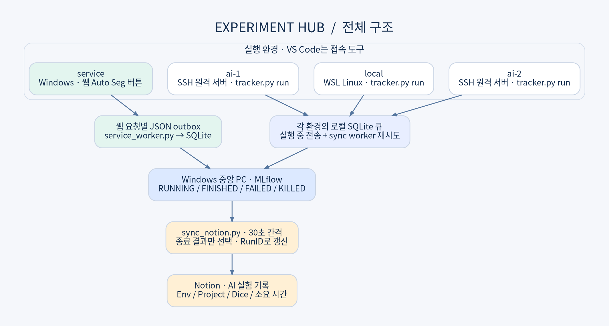
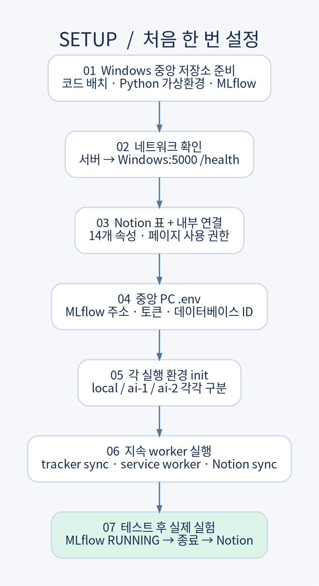
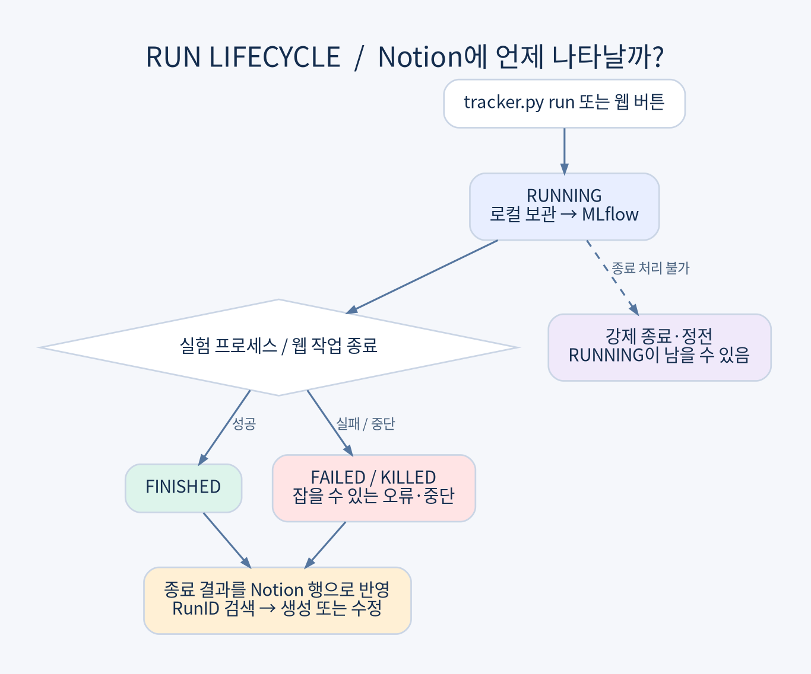
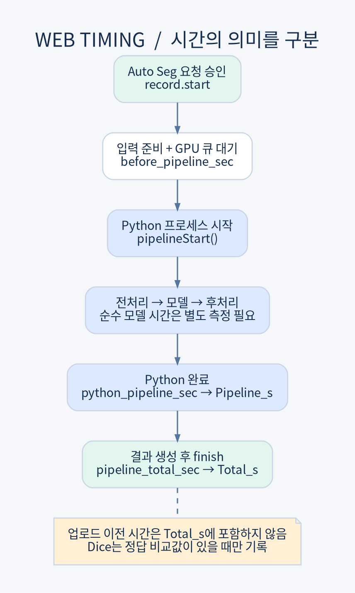
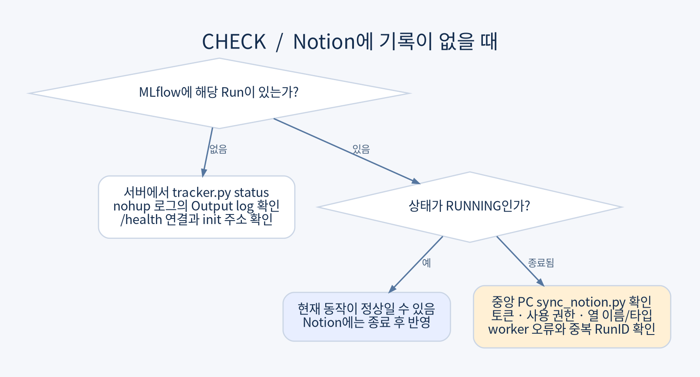

# Experiment Hub

**Windows 웹 서비스, WSL, 두 AI 서버의 실험을 MLflow에 모으고 Notion에 종료 결과를 기록**

VS Code는 개발·접속 도구, 실제 실험이 실행되는 OS와 서버를 기준으로 `service`, `local`, `ai-1`, `ai-2`를 구분



> 공개용 참조 구현로 기존 추적기를 정리했고 Notion worker는 독립 실행형으로 새로 구성함. 회사 웹 라우트 원본, 모델, 실제 데이터, 토큰은 포함하지 않음. 운영 중인 설치는 먼저 [이전 안내](docs/MIGRATION.md)를 확인.

## 목차

- [기능과 범위](#기능과-범위)
- [구현 과정](#구현-과정)
- [설치 순서](#설치-순서)
- [실험 실행](#실험-실행)
- [웹 버튼 연결](#웹-버튼-연결)
- [Notion 표와 지표](#notion-표와-지표)
- [운영 및 문제 해결](#운영-및-문제-해결)
- [테스트와 한계](#테스트와-한계)

## 기능과 범위

| 기능 | 동작 |
|---|---|
| CLI 실험 | `tracker.py run -- 기존 명령`으로 시작·종료·실패 기록 |
| 환경 분리 | 실행 환경 Env와 호출 출처 Source를 별도 기록 |
| nnU-Net | dataset / fold / plans를 구분하고 새 validation summary에서 Dice 수집 |
| 일반 Python | 실행별 숫자 JSON 또는 Experiment API로 지표 전달 |
| 웹 추론 | 요청별 기록기를 붙여 버튼 실행 한 건마다 기록 |
| 오프라인 보관 | 로컬 SQLite 큐에 저장하고 서버 복구 후 재전송 |
| Notion | 종료된 Run을 RunID로 찾아 생성·갱신, 동일 내용 재전송 생략 |
| 실시간 상태 | MLflow에서 RUNNING 확인. Notion에는 종료 결과만 표시 |

모든 Python 명령을 자동 감지하지 않음. **CLI 래퍼 또는 코드 연동을 거쳐야 함.** 이미 실행 중인 학습에는 소급 연결하지 않으며 epoch별 loss·GPU 모니터링은 자동 수집하지 않음.

## 구현 과정

1. Windows에 MLflow를 설치해 중앙 저장소 만들기.
2. 네 환경에서 연결 테스트를 수행하고 실행 환경을 태그로 구분.
3. Notion 데이터베이스와 내부 연결을 만들고 종료 결과 전송 worker를 연결.
4. 학습 명령만 실행하면 기록되지 않는 문제를 해결하기 위해 CLI 래퍼 만들기.
5. nnU-Net 결과 파일의 변경 여부를 확인해 이전 학습의 Dice가 새 실행에 들어가지 않도록 함.
6. 웹 서비스는 명령어 대신 버튼으로 실행하므로 백엔드 요청별 기록기와 별도 전송 worker를 연결.
7. 순수 inference와 파이프라인 시간을 분리하고 공개 코드에서 로컬 결과 경로 전송을 제거.

## 저장소 구성

| 경로 | 역할 |
|---|---|
| tracker.py | 환경 설정, 로컬 큐, CLI 래퍼, MLflow 전송 |
| sync_notion.py | 중앙 PC의 Notion 동기화 |
| service_worker.py | 웹 JSON outbox → MLflow |
| service/service_experiment_tracker.js | Node 요청별 비동기 기록기 |
| service/integration_example.js | 기존 웹 백엔드에 붙이는 예제 |
| examples/demo_metrics.py | 모델 없는 합성 지표 테스트 |
| .env.example | 중앙 PC 설정 템플릿 |
| requirements-hub.txt | 중앙 MLflow 의존성 |
| tests/ | Python 자동 테스트 |
| docs/ | 운영·이전 안내, PNG·SVG 그림, 편집 가능한 원본 |

## 설치 순서



### 1. 준비

| 위치 | 요구 사항 | 역할 |
|---|---|---|
| Windows 중앙 PC | Python 3.10+, MLflow 3.18.0 | 중앙 저장소, Notion worker |
| WSL local | Python 3.9+ | init --env local, CLI 실험 |
| AI 서버 1·2 | Python 3.9+, 기존 conda 환경 | 각 서버에서 init, CLI 실험 |
| Windows 웹 서비스 | 기존 Node 앱, Node 18+ 권장 | 요청별 JS 기록기와 service worker |

추적기와 Notion worker는 Python 표준 라이브러리만 사용함. 학습 라이브러리는 기존 conda 환경에 둡니다. MLflow 설치는 중앙 PC에만 필요함. Node 테스트는 Node 22 기준임.

저장소 파일을 Windows `C:\experiment-hub`, 각 Linux 환경 `~/experiment-hub`에 배치한다고 가정함. `YOUR_WINDOWS_LAN_IP`는 Windows `ipconfig`에서 확인한 IPv4 주소로 수정.

### 2. Windows MLflow 시작

**새 설치용 PowerShell**. 기존 설치에서는 기존 실행 명령과 DB 경로를 유지하고 스킵. 다른 DB를 열면 이전 실험이 보이지 않을 수 있음.

```powershell
cd C:\experiment-hub
py -3.10 -m venv .venv
.\.venv\Scripts\python.exe -m pip install --upgrade pip
.\.venv\Scripts\python.exe -m pip install -r requirements-hub.txt
New-Item -ItemType Directory -Force runtime
$HubIP = "YOUR_WINDOWS_LAN_IP"
.\.venv\Scripts\mlflow.exe server --host 0.0.0.0 --port 5000 --backend-store-uri "sqlite:///C:/experiment-hub/runtime/mlflow.db" --artifacts-destination "C:/experiment-hub/runtime/artifacts" --allowed-hosts "localhost:*,127.0.0.1:*,$($HubIP):*"
```

이 창은 켜둔 상태로 유지. 설치된 Python이 다르면 `py -0`으로 확인하고 지원 버전으로 변경. MLflow는 신뢰하는 내부 네트워크에서 사용. 이 코드는 외부 인터넷 공개용 인증/TLS를 구성하지 않음.

### 3. 연결 확인

Windows의 새 PowerShell:

```powershell
Invoke-WebRequest http://127.0.0.1:5000/health
```

WSL 및 **SSH로 접속한 실제 AI 서버 각각에서**:

```bash
curl --connect-timeout 5 http://YOUR_WINDOWS_LAN_IP:5000/health
```

WSL에서 연결된다고 AI 서버에서도 연결되는 것은 아님. 각각 확인. 방화벽·라우팅 점검은 [운영 문서](docs/OPERATIONS.md)를 참고.

### 4. Notion 준비

1. 새 페이지의 이름을 `AI 실험 기록`으로 지정.
2. **데이터베이스 → 표**를 만들기. 일반 텍스트 표가 아니라 속성 타입이 있는 데이터베이스.
3. 첫 열 제목을 `Name`으로 바꾸기. 셀 안에 Name을 쓰는 것이 아님.
4. 아래 [속성 표](#notion-표와-지표)대로 열 14개를 구성. 대소문자·밑줄도 맞추기.
5. [Notion 내부 연결 관리](https://www.notion.so/profile/integrations)에서 `Experiment Logger` 내부 연결 만들기.
6. 콘텐츠 읽기·삽입·업데이트를 허용합니다. 사용자 이메일 권한은 필요하지 않음.
7. 연결의 **콘텐츠 사용 권한**에 대상 페이지/데이터베이스를 추가함. 또는 페이지의 연결 메뉴에서 내부 연결을 추가. UI 명칭은 버전에 따라 다를 수 있음.
8. 토큰은 본인 PC의 .env에만 저장.
9. 데이터베이스 링크에서 UUID를 확인. `?v=` 뒤는 보기 ID이므로 사용하지 않음.

Env의 선택 옵션: service, local, ai-1, ai-2, unknown. Status의 선택 옵션: FINISHED, FAILED, KILLED. **Status 속성 타입은 Notion의 '상태'가 아니라 '선택'**임.

### 5. .env와 Notion worker

```powershell
cd C:\experiment-hub
Copy-Item .env.example .env
notepad .env
```

설정 채우기. 다음은 자리표시자이며 실제 값으로 바꿔야 함.

```dotenv
MLFLOW_TRACKING_URI=http://127.0.0.1:5000
MLFLOW_PUBLIC_URL=http://YOUR_WINDOWS_LAN_IP:5000
NOTION_TOKEN=본인의_내부연결_토큰
NOTION_DATABASE_ID=데이터베이스_UUID
NOTION_DATA_SOURCE_ID=
SYNC_INTERVAL_SECONDS=30
```

전체 URL은 넣지 않아야 함. 코드가 데이터베이스에서 데이터 소스 ID를 찾음. 여러 소스가 있으면 NOTION_DATA_SOURCE_ID를 직접 지정. API 버전은 2025-09-03으로 고정.

```powershell
.\.venv\Scripts\python.exe -X utf8 sync_notion.py --check
.\.venv\Scripts\python.exe -X utf8 -u sync_notion.py
```

`--check`는 권한·열 이름·타입을 검증하고 행은 쓰지 않음. 첫 동기화는 **모든 활성 MLflow 실험의 종료 Run**을 조회. 같은 RunID가 Notion에 있으면 해당 행을 갱신함.

### 6. 각 실행 환경 초기화

환경에 맞는 명령 하나를 실행. Windows 설정은 WSL이나 SSH 서버에 공유되지 않음.

```bash
# AI 서버 1에서
python3 ~/experiment-hub/tracker.py init --env ai-1 --uri http://YOUR_WINDOWS_LAN_IP:5000
# AI 서버 2에서
python3 ~/experiment-hub/tracker.py init --env ai-2 --uri http://YOUR_WINDOWS_LAN_IP:5000
# WSL에서
python3 ~/experiment-hub/tracker.py init --env local --uri http://YOUR_WINDOWS_LAN_IP:5000
```

큐는 각 환경의 `~/.experiment-tracker/queue.sqlite3`에 저장됨. 다른 서버로 이전할 때 기존 큐의 URI를 덮어쓰지 않음. 새 EXPERIMENT_TRACKER_HOME을 지정하고 기존 대기 기록을 별도로 처리함.

### 7. 지속 전송 worker

각 Linux 환경에서:

```bash
nohup python3 -u ~/experiment-hub/tracker.py sync > ~/experiment-hub/tracker-sync.log 2>&1 &
```

실험 래퍼도 실행 중 임시 전송 스레드를 실행. 지속 worker는 실험이 끝난 뒤에도 중앙 서버가 꺼져 전송하지 못한 기록을 재시도함. 재부팅 후 직접 다시 켜야 함.

### 8. 모델 없는 연결 테스트

```bash
cd ~/experiment-hub
mkdir -p runtime
METRICS_FILE="$PWD/runtime/demo-$(date +%s)-$$.json"
python3 tracker.py run --project connection-demo --model synthetic-demo --job test --metrics-file "$METRICS_FILE" -- python3 examples/demo_metrics.py --output "$METRICS_FILE"
```

MLflow의 connection-demo와 Notion 행을 확인. Dice 0.9와 Inference_s 0.25는 **연결 테스트용 합성 값**임. 모델 성능이 아님.

## 실험 실행



### nnU-Net

```bash
conda activate nnunetv2
mkdir -p ~/nnunet/logs
CUDA_VISIBLE_DEVICES=1 nohup python3 -u ~/experiment-hub/tracker.py run -- nnUNetv2_train 302 3d_fullres 2 -p nnUNetResEncUNetMPlans > ~/nnunet/logs/tracked_302_fold2.log 2>&1 &
```

- 이 명령은 새 학습을 시작. 진행 중인 동일 fold에 다시 실행하지 않음.
- python3는 3.9 이상이어야 함. 추적기만 다른 Python으로 실행하더라도 하위 nnUNet 명령은 활성 conda PATH에서 찾음.
- nnUNet_results와 필요시 nnUNet_preprocessed 환경 변수가 있어야 함.
- 자동 nnU-Net 감지를 사용하려면 `--project`를 생략. 지정하면 일반 명령 모드임.
- 이번 실행에서 생성·변경된 `validation/summary.json`의 foreground_mean.Dice만 읽음. 기존 파일은 건너뜀.
- 같은 결과 디렉토리에 여러 학습을 동시에 쓰지 않음.
- 종료 코드 0이어도 지표를 못 읽으면 FINISHED에 metric_warning이 붙을 수 있음.

```bash
tail -n 80 ~/nnunet/logs/tracked_302_fold2.log
python3 ~/experiment-hub/tracker.py status
```

실제 학습 로그는 외부 nohup 로그가 아니라 그 안의 **Output log:** 경로임. `~/.experiment-tracker/logs/<실행ID>.log`를 tail -f로 확인함.

### 일반 Python 평가

```bash
python3 ~/experiment-hub/tracker.py run --project bone-seg --model model-v1 --job evaluate --metrics-file /absolute/path/unique-run-metrics.json -- python evaluate.py
```

본인의 evaluate.py가 해당 JSON을 실제로 써야 함. 실행마다 고유한 경로를 사용. 값 예시:

```json
{"dice_mean": 0.91, "hd95_mean_mm": 1.4, "model_inference_mean_sec": 2.1}
```

숫자 지표는 MLflow에 저장됨. Notion은 아래 매핑에 있는 값만 표시. 정답 없이 Dice를 만들거나 전체 시간을 순수 inference 시간으로 대신 채우지 않음. GPU 비동기 연산은 적절히 동기화한 모델 구간에서 측정해야 함.

### Python API

tracker.py를 import할 수 있는 위치에 두고 지속 sync worker를 유지.

```python
from tracker import Experiment
with Experiment('bone-seg', model='model-v1', job='evaluate') as record:
    result = evaluate_model()  # 본인의 함수
    record.log(dice_mean=result['dice'])
```

Experiment API 자체는 네트워크 worker를 시작하지 않음. 로컬 디스크 오류는 호출자에 전파될 수 있음.

## 웹 버튼 연결

앱 전체를 `tracker.py run -- npm ...`으로 실행하면 서버 프로세스 한 건이 기록됨. **추론 요청 한 건마다** 기록하려면 백엔드 연동이 필요.



1. service/service_experiment_tracker.js를 기존 웹 프로젝트의 services 폴더에 복사.
2. service/integration_example.js를 참고하여 Auto Seg 핸들러를 수정.
3. 요청 검증 후 start(segType)를 호출.
4. GPU 큐 슬롯을 얻은 뒤 Python 실행 직전에 pipelineStart()를 호출. 반환된 함수는 Python 완료/콜백 시 호출.
5. 결과 생성 성공 시 finish(true, result), 실패 시 finish(false)를 호출. HTTP 200 본문에도 오류가 있을 수 있으므로 HTTP 코드만 보지 않음.
6. 진행 중 요청이 끝난 뒤 웹 서버를 재시작.
7. 같은 Windows 계정의 새 PowerShell에서 전송 worker를 켜기.

```powershell
cd C:\experiment-hub
.\.venv\Scripts\python.exe -X utf8 -u service_worker.py --uri http://127.0.0.1:5000
```

이 저장소는 특정 회사 라우트를 자동 패치하지 않음. 기존 비공개 패치를 이미 적용했다면 중복 삽입하지 마세요. 다른 endpoint는 각각 연결해야 함.

웹 기록기는 허용 목록의 segmentation 타입, 임의 UUID, 상태, 시간, STL 개수만 기록. 환자명·ZIP명·DICOM 경로·원본 오류·결과 객체 전체는 전송하지 않음. Notion 토큰은 웹 앱에 넣지 않음.

## Notion 표와 지표

| 속성 | Notion 타입 | 의미 |
|---|---|---|
| Name | 제목 | 실행 이름 |
| Project | 텍스트 | MLflow 실험 이름 |
| Source | 텍스트 | vscode / service 등 호출 출처 |
| Env | 선택 | 실제 실행 환경 |
| Job | 선택 | train / evaluate / inference / test |
| Model | 텍스트 | 모델/설정 표시명; 가중치 해시가 아님 |
| Started | 날짜 | 시작 시각; UTC 전달, Notion에서 표시 |
| Status | 선택 | FINISHED / FAILED / KILLED |
| Dice | 숫자 | dice_mean; 0~1 원값 |
| Inference_s | 숫자 | model_inference_mean_sec; 별도 측정값 |
| Pipeline_s | 숫자 | python_pipeline_sec; 웹 Python 파이프라인 |
| Total_s | 숫자 | pipeline_total_sec; CLI 전체 / 웹 승인 후 처리 |
| RunID | 텍스트 | MLflow Run ID, 중복 방지 검색 키 |
| MLflow | URL | 상세 실행 링크 |

추천 보기: **Env로 그룹화**, Started 내림차순, Project 필터. Source로만 그룹화하면 ai-1·ai-2·local이 vscode 그룹에 함께 나타날 수 있음.

## 운영 및 문제 해결



| 현상 | 확인 |
|---|---|
| 학습 중 Notion에 안 보임 | 정상일 수 있음. MLflow RUNNING 확인 |
| MLflow에도 없음 | /health, 환경별 init URI, tracker.py status의 PENDING |
| 끝났는데 Notion에 없음 | sync_notion.py 실행과 토큰·권한·열 타입 |
| Dice가 비어 있음 | 새 summary 및 유효한 foreground_mean.Dice |
| 웹 시간이 비어 있음 | 실제 핸들러 연동 및 동일 사용자 계정 worker |
| 중복 RunID 오류 | 기존 중복 행 확인 후 하나만 남김 |
| 재부팅 후 안 됨 | 중앙 서버와 필요한 worker 재시작 |

```bash
python3 ~/experiment-hub/tracker.py sync --once
```

학습을 재실행하지 않고 전송만 재시도함. 강제 종료/정전은 RUNNING을 남길 수 있음. PID 유무만으로 성공/실패를 추정하지 않음.

[운영과 복구](docs/OPERATIONS.md) · [이전 안내](docs/MIGRATION.md)


## 참고 문서

- [MLflow Tracking Server](https://mlflow.org/docs/latest/self-hosting/architecture/tracking-server/)
- [MLflow Network Security](https://mlflow.org/docs/latest/self-hosting/security/network/)
- [Notion data source 전환](https://developers.notion.com/docs/upgrade-guide-2025-09-03)
- [Notion data source query](https://developers.notion.com/reference/query-a-data-source)
